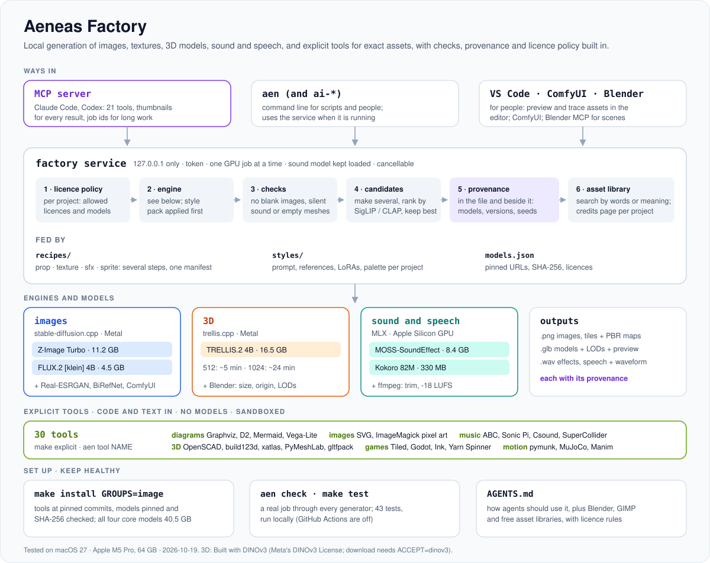

# Aeneas Factory

**Images, 3D models and sound effects from open models, offline on your Mac.** One `make install` builds the tools at pinned commits and downloads checksummed model weights. Three commands then turn prompts into PNGs, GLBs and WAVs, and every file they make carries a record of how it was made.

<p align="center">
  
</p>

It is the stack I use for game and prototype work: small enough to understand, open-licensed, and set up so that an AI coding agent can use it too (see [AGENTS.md](AGENTS.md)).

- **Local.** No API keys, no accounts, nothing leaves the machine after the downloads.
- **Reproducible.** Every tool is pinned to a commit and every model file to a Hugging Face commit and a SHA-256.
- **Accountable.** Each output gets an `<output>.json` sidecar: the models, their licences, whether commercial use is allowed, the prompt, the seed, the settings, input and output checksums and the exact command.
- **Open licences.** Apache-2.0 and MIT models; the one exception to read before shipping is listed under [Licences](#licences).

## Gallery

Every picture and sound below was made by this repository with [`scripts/make_gallery.sh`](scripts/make_gallery.sh) (fixed seeds, so you can make the same ones) and has its sidecar beside it in [`docs/gallery`](docs/gallery).

| | |
|---|---|
|  |  |
| **Text to image**, Z-Image Turbo, 1024 px, 8 steps<br>`ai-image "a weathered wooden treasure chest with iron bands and a brass lock, …" --seed 11 -o chest.png` | **Editing**, FLUX.2 [klein] 4B with the first picture as reference<br>`ai-image "paint the wooden planks … a deep blue, …" --model flux2-klein-4b --ref chest.png -o chest-blue.png` |
|  |  |
| **Image to 3D**, TRELLIS.2 from `chest.png`: a UV-unwrapped, textured [`chest.glb`](docs/gallery/chest.glb), rendered in Blender<br>`ai-3d chest.png -o chest.glb` | **Seamless texture**, Z-Image Turbo with `--tile`, shown repeated two by two<br>`ai-image "rounded grey river cobblestones packed tightly together, green moss in the gaps, …" --tile --size 512 -o cobbles.png` |


**Sound effect**, MOSS-SoundEffect v2.0, 5 s at 48 kHz: [`chest-creak.wav`](docs/gallery/chest-creak.wav)<br>
`ai-sfx "an old wooden chest lid creaks open slowly, then thuds shut" --seconds 5 -o chest-creak.wav`

## Quick start

```bash
brew install cmake uv git-lfs     # plus the Xcode Command Line Tools: xcode-select --install
git clone https://github.com/tgergo1/aeneas-factory.git
cd aeneas-factory
make install                      # tools (~1 GB) + all models (40.5 GB) + a health check
```

Then:

```bash
export PATH="$PWD/bin:$PATH"
ai-image "a lighthouse on a cliff at dawn, watercolour" -o lighthouse.png
ai-image "a single red armchair on a plain white background, studio photo" -o chair.png
ai-3d chair.png -o chair.glb
ai-sfx "rain on a tin roof, steady, distant thunder" --seconds 10 -o rain.wav
```

The gallery images are stored with Git LFS. Without `git-lfs` the clone still works; the gallery files are just small pointer files. To skip them on purpose: `GIT_LFS_SKIP_SMUDGE=1 git clone …`.

## Requirements

| | |
|---|---|
| Machine | A Mac with Apple Silicon. Tested on an M5 Pro with 64 GB, macOS 27. The sound model alone peaked at 14 GB of GPU memory. |
| Disk | About 42 GB: 40.5 GB of models, about 1 GB of tool builds. Any one group can be installed alone (below). |
| Software | Xcode Command Line Tools, Homebrew `cmake`, `uv` and `git`; `curl` and Python 3 come with macOS. `make prereqs` checks all of it. |
| Optional | Blender (`scripts/render_glb.py` previews), ffmpeg (the gallery script), GIMP. |
| Time | Building the three tools from a clean clone took 6.5 minutes on the M5 Pro; the downloads depend on your connection and resume if interrupted. |

**Not on a Mac?** `stable-diffusion.cpp` and `trellis.cpp` build on Linux and Windows with CUDA, Vulkan or ROCm: pass the backend with `CMAKE_ARGS`, for example `make sd trellis CMAKE_ARGS="-DSD_CUDA=ON -DGGML_CUDA=ON"`. That path is untested here. `ai-sfx` runs on MLX and needs Apple Silicon.

## Install step by step

| Command | Does |
|---|---|
| `make prereqs` | Checks the platform, the build tools and the free disk space |
| `make tools` | Builds `sd-cli` and `trellis-cli` with Metal and sets up the MOSS Python env, each at its pinned commit (`make sd`, `make trellis`, `make moss` one at a time) |
| `make models` | Downloads every model, 40.5 GB. Or one group: `make models-image` (15.7 GB), `make models-3d` (16.5 GB), `make models-sound` (8.4 GB) |
| `make check` | Runs `bin/ai-check`: the tools, every model file, and a tiny job through each generator (about 7 minutes). `make check-quick` skips the jobs |
| `make verify` | Checks the SHA-256 of every downloaded file |
| `make list` | Lists the models and whether each is downloaded |
| `make clean-tools` | Removes the builds, keeps the sources and the models |

Downloads land as `<file>.part`, resume where they stopped, and are kept only once the checksum matches. If you only need images, `make sd models-image` is enough.

## What it installs

### Models

| Model | Group | Size | Does | Licence | Source |
|---|---|---|---|---|---|
| Z-Image Turbo (Q8 GGUF) + Qwen3-4B text encoder + VAE | image | 11.2 GB | Text to image in 8 steps; image to image; seamless tiles | Apache-2.0 | [Tongyi-MAI/Z-Image-Turbo](https://huggingface.co/Tongyi-MAI/Z-Image-Turbo), GGUF by [leejet](https://huggingface.co/leejet/Z-Image-Turbo-GGUF) and [unsloth](https://huggingface.co/unsloth/Qwen3-4B-Instruct-2507-GGUF) |
| FLUX.2 [klein] 4B (Q8 GGUF) + VAE | image | 4.5 GB | Text to image in 4 steps; editing from reference images | Apache-2.0 | [black-forest-labs/FLUX.2-klein-4B](https://huggingface.co/black-forest-labs/FLUX.2-klein-4B), GGUF by [leejet](https://huggingface.co/leejet/FLUX.2-klein-4B-GGUF) |
| TRELLIS.2 4B (GGUF set) | 3d | 16.5 GB | One image to a textured, UV-unwrapped GLB; DINOv3 features, BiRefNet matting | MIT; DINOv3 License for `dinov3.gguf` | [microsoft/TRELLIS.2-4B](https://huggingface.co/microsoft/TRELLIS.2-4B), GGUF by [ilintar](https://huggingface.co/ilintar/trellis2-gguf) |
| MOSS-SoundEffect v2.0 (MLX bf16) | sound | 8.4 GB | Sound effects, foley and ambience from a description; 48 kHz, up to 30 s | Apache-2.0 | [OpenMOSS-Team/MOSS-SoundEffect-v2.0](https://huggingface.co/OpenMOSS-Team/MOSS-SoundEffect-v2.0), MLX by [mlx-community](https://huggingface.co/mlx-community/MOSS-SoundEffect-v2.0-bf16) |

The full list, with every file's URL (pinned to a commit), size and SHA-256, is [`models.json`](models.json). FLUX.2 klein reuses Z-Image's Qwen3-4B text encoder, so downloading it also fetches `z-image-turbo`.

### Tools

| Tool | Pinned commit | Licence | Used by |
|---|---|---|---|
| [stable-diffusion.cpp](https://github.com/leejet/stable-diffusion.cpp) | `59c23bc` | MIT | `ai-image` |
| [trellis.cpp](https://github.com/pwilkin/trellis.cpp) | `2516c48` | MIT | `ai-3d` |
| [moss-soundeffect-mlx](https://github.com/xocialize/moss-soundeffect-mlx) | `4e8e3e3` | Apache-2.0 | `ai-sfx`, with the package versions in [`requirements/moss-sfx.txt`](requirements/moss-sfx.txt) |

## The commands

All of them take `--help`. Each writes `out.<ext>`, `out.<ext>.json` (the sidecar) and `out.<ext>.log` (the tool's own output).

**`ai-image`** (stable-diffusion.cpp)

```bash
ai-image "a thatched cottage at dusk, oil painting" -o cottage.png                 # Z-Image Turbo, 1024 px
ai-image "..." --model flux2-klein-4b --size 768 --seed 7 -o out.png              # FLUX.2 klein
ai-image "make the roof slate grey" --model flux2-klein-4b --ref in.png -o out.png # edit (repeat --ref for more)
ai-image "weathered oak planks" --init photo.png --strength 0.4 -o oak.png         # image to image
ai-image "mossy cobblestones, top-down" --tile --size 512 -o cobbles.png           # seamless tile
```

Also `-W/-H`, `--steps`, `--cfg`, `--neg`, and anything after `--` goes to `sd-cli` unchanged. The VAE decodes on the CPU by default, because the Metal decode came out blank with this build; `--gpu-vae` switches it back.

**`ai-3d`** (trellis.cpp)

```bash
ai-3d chair.png -o chair.glb                  # 1024 geometry, textured
ai-3d chair.png -o chair.glb --res 512        # lighter and faster
ai-3d chair.png -o chair.glb --no-texture     # geometry only
```

One object on a plain or transparent background works best; BiRefNet mattes everything else. A good recipe is to generate the picture with `ai-image "<object>, a single object centred on a plain white background, studio photo"` first. trellis.cpp also leaves `<name>.ply` and `<name>_base.png` beside the GLB. To look at the result: `Blender -b --factory-startup --python scripts/render_glb.py -- chair.glb chair-preview.png`.

**`ai-sfx`** (MOSS-SoundEffect)

```bash
ai-sfx "a heavy wooden door creaks open slowly" -o door.wav
ai-sfx "rain on a tin roof, steady" --seconds 12 --seed 4 -o rain.wav
ai-sfx "..." --steps 30 -o quick.wav          # rougher, about three times faster
```

The default is 100 steps and cfg 4.0. A take costs about the same whatever its length, and the very first run also compiles Metal shaders.

**`ai-models`** and **`ai-check`**

```bash
ai-models list                 # what is downloaded
ai-models find sound           # search by capability
ai-models download 3d          # all | image | 3d | sound | a model id
ai-models verify --full        # SHA-256 of every file
ai-check                       # health check; --quick, --full, --skip 3d, --keep DIR
```

## The provenance sidecar

Here is the one written next to `chest-blue.png`, shortened:

```json
{
  "generated_by": "aeneas-factory bin/ai-image",
  "created": "2026-10-14T16:14:21+02:00",
  "seconds": 166.9,
  "output": "chest-blue.png",
  "output_sha256": "0e6041a30b42d99b11ddafe92ae15a591f176a028cfb1e11fb456d840b8420ff",
  "models": [
    {
      "id": "flux2-klein-4b",
      "licence": "Apache-2.0",
      "commercial_output": "yes"
    },
    {
      "id": "z-image-turbo",
      "licence": "Apache-2.0",
      "commercial_output": "yes"
    }
  ],
  "prompt": "paint the wooden planks of the chest a deep blue, keep the iron bands, the brass lock and the white background",
  "seed": 11,
  "params": {
    "width": 1024,
    "height": 1024,
    "steps": 4,
    "cfg": 1.0
  },
  "inputs": [
    {
      "file": "chest.png",
      "sha256": "9813f87eb60d3bc8f0df630b31bee6cb99b1cfb7a1105d7d4fdf9253275a4722"
    }
  ],
  "command": [
    "aeneas-factory/tools/stable-diffusion.cpp/build/bin/sd-cli",
    "--diffusion-model",
    "aeneas-factory/models/flux2-klein-4b/flux-2-klein-4b-Q8_0.gguf",
    "…"
  ]
}
```

That is what a credits page, a store's AI-content disclosure or a colleague asking "how did you make this?" needs. Keep the `.json` with the file.

## Using it from an AI agent

[`AGENTS.md`](AGENTS.md) (also read by Claude Code through [`CLAUDE.md`](CLAUDE.md)) tells an agent how to call the generators. It also points the agent to Blender, GIMP, ffmpeg and a list of free asset libraries: Inside Out Library, Poly Haven, ambientCG, Kenney, Sketchfab, Fab, Mixamo, MakeHuman and others. It sets the rules: record every source and licence, check commercial use, ask before buying or signing up anywhere.

To let an agent find the factory from any project, add a line to your global instructions (`~/.claude/CLAUDE.md` for Claude Code, `~/.codex/AGENTS.md` for Codex):

```markdown
Local generators for images, 3D models and sound effects are in ~/aeneas-factory (read its AGENTS.md); do not download second copies of its models.
```

**Optional: Blender over MCP.** [MCP for Blender](https://github.com/ahujasid/blender-mcp) lets an agent inspect a scene, run Python in it and take viewport pictures. It is not part of this repository and not installed by it. Its add-on opens a local socket that runs any Python it is sent, without authentication, so turn it on only on a machine you trust. If you use it, turn its telemetry off: `DISABLE_TELEMETRY=true` for the server, and leave the add-on's "Allow Telemetry" preference unticked.

## Layout

```
aeneas-factory/
├── Makefile              build, download, check
├── models.json           the register: every model file, pinned URL, size, SHA-256, licence
├── bin/
│   ├── ai-image          image from text, edits, tiles      (stable-diffusion.cpp)
│   ├── ai-3d             image to textured GLB              (trellis.cpp)
│   ├── ai-sfx            sound effect from text             (MOSS-SoundEffect, MLX)
│   ├── ai-models         list, find, download, verify
│   ├── ai-check          health check
│   └── _ailib.py         shared: register, running tools, sidecars
├── requirements/         pinned Python packages for the MOSS env
├── scripts/              render_glb.py (Blender preview), make_gallery.sh
├── docs/                 factory.svg, gallery/ (Git LFS)
├── AGENTS.md, CLAUDE.md  notes for AI agents
├── models/               downloaded weights (git-ignored)
└── tools/                built tools (git-ignored)
```

Everything stays inside the clone. Set `AEN_HOME` to use the commands from another checkout.

## Troubleshooting

- **A blank or black image**: the default already decodes the VAE on the CPU for this reason. If you passed `--gpu-vae`, drop it.
- **Running out of memory**: use `--size 768` or less for images, and `--res 512` for 3D. Close other GPU-heavy apps; the sound model alone needs about 14 GB.
- **A download stopped**: run the same `make models…` again; it resumes and checks each file.
- **Something broke after a macOS or Homebrew update**: `make check-quick` shows what. `make clean-tools tools` rebuilds.
- **Each command's `.log`** has the tool's full output; failures print its last lines.

## Licences

The code and documents in this repository are under the [MIT License](LICENSE). The tools and models keep their own licences, summarised above and per file in [`models.json`](models.json):

- **Z-Image Turbo, Qwen3-4B, FLUX.2 [klein] 4B, MOSS-SoundEffect: Apache-2.0.**
- **TRELLIS.2, trellis.cpp, BiRefNet, stable-diffusion.cpp: MIT.** TRELLIS.2's image features, `dinov3.gguf`, are under Meta's [DINOv3 License](https://ai.meta.com/resources/models-and-libraries/dinov3-license). Read it before you ship 3D models made with this factory.
- **The FLUX.2 [klein] 4B licence is Apache-2.0; the 9B FLUX.2 models are not.** This repository only downloads the 4B one.

Whether you may use a generated file, and how you must disclose it, depends on where it goes. The sidecar gives you the facts to decide.

## Credits

Built on the work of [leejet/stable-diffusion.cpp](https://github.com/leejet/stable-diffusion.cpp), [pwilkin/trellis.cpp](https://github.com/pwilkin/trellis.cpp), [xocialize/moss-soundeffect-mlx](https://github.com/xocialize/moss-soundeffect-mlx), [Apple MLX](https://github.com/ml-explore/mlx), and the model authors: Tongyi-MAI (Z-Image), Black Forest Labs (FLUX.2), Microsoft (TRELLIS.2), Meta (DINOv3), the BiRefNet authors, Qwen, and OpenMOSS. Thanks also to the GGUF and MLX converters: leejet, unsloth, ilintar and mlx-community.
